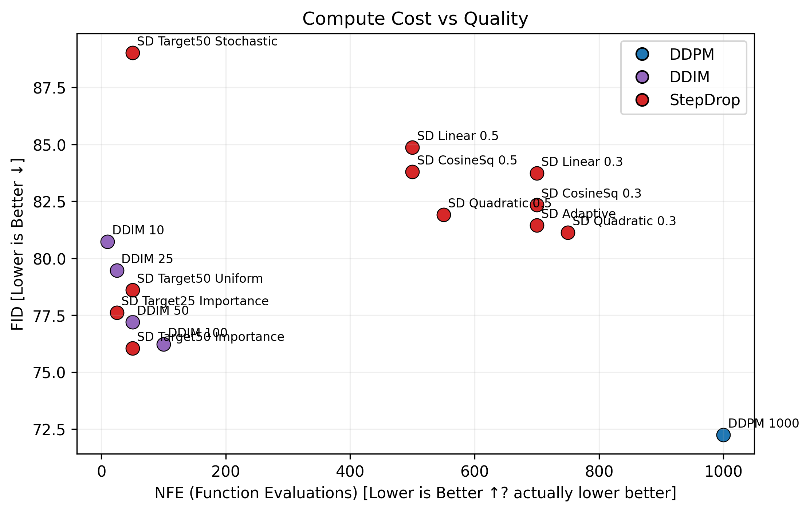
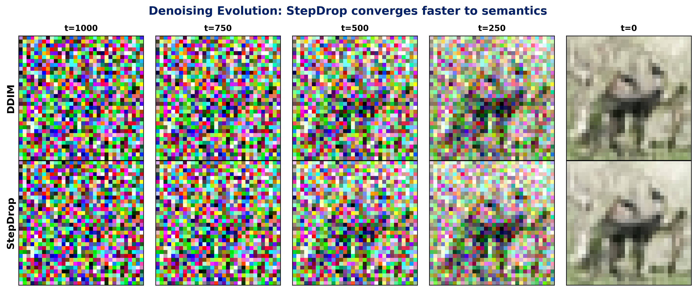
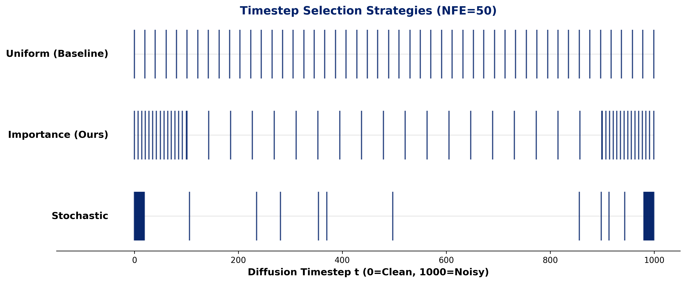
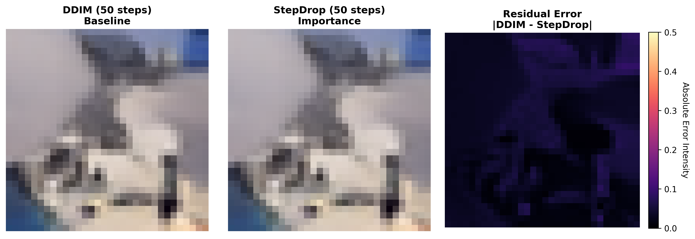

## Introduction {#sec-intro}

Generative modeling has witnessed remarkable progress over the past decade, with diffusion models emerging as a dominant paradigm for high-fidelity image synthesis. Unlike Generative Adversarial Networks (GANs), which rely on adversarial training dynamics prone to mode collapse, or Variational Autoencoders (VAEs), which often produce blurry outputs, diffusion models achieve state-of-the-art generation quality through a principled probabilistic framework based on iterative denoising [@ho2020denoising; @song2020denoising].

However, sampling is slow: DDPM [@ho2020denoising] typically needs $\sim 1000$ U-Net forward passes per image, which is impractical for real-time or edge settings. DDIM [@song2020denoising] and solver-based methods (e.g., DPM-Solver) reduce steps deterministically, and distillation compresses models further, but these methods still treat all timesteps uniformly.

Recent work hints that timesteps contribute unevenly to quality [@wang2024s2dms; @xue2024accelerating]: early steps establish structure, late steps add texture, and mid-trajectory steps contribute least. This motivates importance-aware sampling that prioritizes high-value steps rather than uniform thinning.

This observation raises a natural question: *if timesteps contribute unevenly to perceptual quality, can we design sampling strategies that focus computation on high-importance steps while reducing effort on redundant ones?* Such an approach would move beyond uniform step allocation toward importance-weighted sampling, potentially achieving better quality-efficiency tradeoffs.

In this work, we investigate this question in the context of *tiny diffusion models*—lightweight architectures with fewer than 10 million parameters designed for efficient deployment. These models are particularly relevant for edge computing and mobile applications, where computational and memory constraints are paramount. We hypothesize that tiny models, due to their limited capacity, may exhibit even more pronounced temporal redundancy, making them ideal candidates for importance-aware acceleration.

We propose **StepDrop** [@martins2025stepdrop], a retraining-free acceleration framework that employs stochastic step skipping with importance-weighted selection. Rather than uniformly subsampling timesteps, StepDrop uses configurable skip schedules—including uniform, quadratic, cosine, and adaptive variants—that encode different priors about timestep importance. The stochastic formulation allows flexible compute-quality tradeoffs while the importance weighting concentrates computation on high-value denoising stages.

The remainder of this paper is organized as follows. @sec-objectives formalizes our research objectives. @sec-related reviews related work on diffusion models and acceleration techniques. @sec-method presents the StepDrop methodology, including the mathematical formulation and skip schedule variants. @sec-experiments describes our experimental setup, and @sec-results presents quantitative and qualitative results. Finally, @sec-conclusion discusses implications and future directions.

## Objectives {#sec-objectives}

The primary goal of this work is to investigate whether stochastic step skipping can accelerate tiny diffusion models while preserving, or even improving, generation quality compared to standard deterministic sampling. We structure our investigation around the following objectives:

- **Train a Baseline Tiny Diffusion Model.** We train a lightweight U-Net on CIFAR-10 [@krizhevsky2009learning] using DDPM [@ho2020denoising] to establish reference metrics for quality and compute.

- **Implement Importance-Weighted Schedulers.** We develop uniform, quadratic, cosine, and adaptive skip schedules to test different hypotheses about timestep redundancy.

- **Enable Probabilistic Step Omission.** We integrate stochastic skipping into DDIM [@song2020denoising], preserving critical boundary steps while pruning redundant mid-trajectory updates.

- **Compare Stochastic vs. Deterministic Reduction.** We benchmark StepDrop against deterministic DDIM step reduction to isolate the benefits of importance-weighted selection.

- **Evaluate Quality and Efficiency.** We assess performance using FID [@heusel2017gans] and IS [@salimans2016improved] alongside GFLOPs and throughput to quantify efficiency gains.

## Related Work {#sec-related}

**Diffusion Models.** Diffusion probabilistic models were introduced by @ho2020denoising, who demonstrated that iterative denoising could produce high-quality samples competitive with GANs. The DDPM framework defines a forward Markov chain that progressively adds Gaussian noise to data, and a reverse chain parameterized by a neural network that learns to denoise. While effective, DDPM requires hundreds to thousands of function evaluations for sampling, limiting practical deployment.

**Accelerated Sampling.** @song2020denoising proposed DDIM, which reformulates diffusion sampling as a deterministic process, enabling the use of non-Markovian subsequences with fewer steps. This insight sparked numerous follow-up works on efficient sampling. DPM-Solver [@lu2022dpm] applies high-order ODE solvers to accelerate the reverse diffusion process, achieving quality results in 10–20 steps. PNDM [@liu2022pseudo] introduces pseudo-numerical methods tailored for the diffusion manifold. These methods focus on improving the numerical integration but still treat all timesteps uniformly.

**Timestep Importance and Selection.** Recent work has begun to question the uniform treatment of timesteps. @xue2024accelerating optimize timestep selection for diffusion sampling, showing that non-uniform schedules can improve quality at fixed budgets. @wang2024s2dms propose Skip-Step Diffusion Models (S2-DMs), which learn to skip steps during training. Our work differs by focusing on *retraining-free* acceleration through stochastic skipping at inference time, making it applicable to any pretrained model without modification.

**Knowledge Distillation.** An orthogonal approach to acceleration involves distilling multi-step diffusion models into fewer-step generators. @zhang2024accelerating propose one-to-many knowledge distillation for diffusion acceleration, while @zhu2024slimflow introduce SlimFlow for training compact one-step models. These methods require additional training and may sacrifice flexibility, whereas StepDrop operates purely at inference time.

## Method {#sec-method}

### Background: Diffusion Models and DDIM Sampling

Diffusion models define a forward process that gradually adds noise to data $\mathbf{x}_0 \sim q(\mathbf{x}_0)$ over $T$ timesteps:

$$
q(\mathbf{x}_t | \mathbf{x}_0) = \mathcal{N}(\mathbf{x}_t; \sqrt{\bar{\alpha}_t}\mathbf{x}_0, (1-\bar{\alpha}_t)\mathbf{I}),
$$ {#eq-forward}

where $\bar{\alpha}_t = \prod_{s=1}^{t} \alpha_s$ and $\alpha_t = 1 - \beta_t$ for a noise schedule $\{\beta_t\}_{t=1}^T$.

The reverse process learns to denoise by predicting the noise $\boldsymbol{\epsilon}_\theta(\mathbf{x}_t, t)$ added at each step. DDPM [@ho2020denoising] uses a stochastic reverse process, while DDIM [@song2020denoising] derives a deterministic update:

$$
\mathbf{x}_{t-1} = \sqrt{\bar{\alpha}_{t-1}} \hat{\mathbf{x}}_0(\mathbf{x}_t, t) + \sqrt{1 - \bar{\alpha}_{t-1}} \cdot \boldsymbol{\epsilon}_\theta(\mathbf{x}_t, t),
$$ {#eq-ddim}

where $\hat{\mathbf{x}}_0(\mathbf{x}_t, t) = \frac{\mathbf{x}_t - \sqrt{1-\bar{\alpha}_t}\boldsymbol{\epsilon}_\theta(\mathbf{x}_t, t)}{\sqrt{\bar{\alpha}_t}}$ is the predicted clean image.

DDIM enables sampling with a subsequence $\tau = \{\tau_1, \tau_2, \ldots, \tau_S\} \subset \{1, \ldots, T\}$ of $S < T$ steps, typically chosen uniformly.

### StepDrop: Importance-Weighted Step Skipping

We propose StepDrop, which modifies the DDIM sampling process by stochastically skipping steps based on their estimated importance. The key insight is that not all timesteps contribute equally to generation quality—boundary steps (early and late) are critical, while mid-trajectory steps are often redundant.

Given a base timestep sequence $\tau = \{\tau_1, \ldots, \tau_S\}$, StepDrop assigns a skip probability $p_{\text{skip}}(\tau_i)$ to each step. At inference time, step $\tau_i$ is skipped with probability $p_{\text{skip}}(\tau_i)$, in which case the sample propagates directly to the next non-skipped step.

**Skip Schedules.** We investigate four skip probability functions:

1. **Uniform:** $p_{\text{skip}}(i) = p_0$, constant across all steps.

2. **Quadratic:** $p_{\text{skip}}(i) = p_0 \cdot 4\left(\frac{i}{S} - \frac{1}{2}\right)^2$, concentrating skips at mid-trajectory.

3. **Cosine:** $p_{\text{skip}}(i) = p_0 \cdot \frac{1}{2}\left(1 + \cos\left(\pi \cdot \frac{|i - S/2|}{S/2}\right)\right)$, smooth bell-shaped distribution.

4. **Adaptive:** $p_{\text{skip}}(i) \propto \|\boldsymbol{\epsilon}_\theta(\mathbf{x}_{\tau_i}, \tau_i)\|^{-1}$, skipping steps where predicted noise magnitude is low.

**Boundary Preservation.** To ensure structural integrity, we enforce $p_{\text{skip}}(\tau_i) = 0$ for the first $k$ and last $k$ steps, preserving critical boundary regions where coarse structure and fine details are established.

### Algorithm

@alg-stepdrop summarizes the StepDrop sampling procedure.

::: {#alg-stepdrop}

| **Input:** noise $\mathbf{x}_T \sim \mathcal{N}(0, \mathbf{I})$, timesteps $\tau$, model $\boldsymbol{\epsilon}_\theta$, schedule type
| **Output:** generated sample $\mathbf{x}_0$
|
| 1:  Compute skip probabilities $\{p_{\text{skip}}(\tau_i)\}$ based on schedule
| 2:  **for** $i = S, S-1, \ldots, 1$ **do**
| 3:  &emsp;Sample $u \sim \text{Uniform}(0, 1)$
| 4:  &emsp;**if** $u < p_{\text{skip}}(\tau_i)$ and $i \notin \text{boundary}$ **then**
| 5:  &emsp;&emsp;Skip step (propagate $\mathbf{x}_{\tau_i}$ directly)
| 6:  &emsp;**else**
| 7:  &emsp;&emsp;Apply DDIM update ([-@eq-ddim])
| 8:  &emsp;**end if**
| 9:  **end for**
| 10: **return** $\mathbf{x}_0$

StepDrop Sampling
:::

## Experiments {#sec-experiments}

### Experimental Setup

**Dataset.** We evaluate on CIFAR-10 [@krizhevsky2009learning], which contains 60,000 $32 \times 32$ color images across 10 classes. We use the standard train/test split with 50,000 training images.

**Model Architecture.** We use a tiny U-Net architecture [@ronneberger2015unet] with approximately 2M parameters, following the implementation of @lucidrains2023diffusion. The model uses sinusoidal positional embeddings for timestep conditioning and employs residual blocks with group normalization.

**Training.** The model is trained using the standard DDPM objective [@ho2020denoising]:

$$
\mathcal{L} = \mathbb{E}_{t, \mathbf{x}_0, \boldsymbol{\epsilon}}\left[\|\boldsymbol{\epsilon} - \boldsymbol{\epsilon}_\theta(\mathbf{x}_t, t)\|^2\right],
$$ {#eq-loss}

with AdamW optimizer, learning rate $10^{-4}$, and batch size 128 for 100 epochs on an NVIDIA A100 GPU.

**Evaluation Metrics.** We report:

- **FID** [@heusel2017gans]: Fréchet Inception Distance measuring distributional similarity (lower is better).
- **IS** [@salimans2016improved]: Inception Score measuring quality and diversity (higher is better).
- **NFE**: Number of function evaluations (U-Net forward passes).
- **GFLOPs**: Computational cost per sample.

**Baselines.** We compare against:

- **DDPM-1000**: Full 1000-step stochastic sampling [@ho2020denoising].
- **DDIM-$k$**: Deterministic sampling with $k$ uniformly-spaced steps [@song2020denoising].

## Results {#sec-results}

### Quantitative Results

@tbl-main-results summarizes quality and efficiency. At 50 NFE, StepDrop (importance) improves FID by 1.15 over DDIM-50 while maintaining IS and similar FLOPs. At 25 NFE, it matches DDIM-50 quality with roughly double throughput.

| Method | NFE | FID $\downarrow$ | IS $\uparrow$ | Throughput (img/s) $\uparrow$ |
|:---------------------------------|-----:|--------:|-------:|-------------:|
| DDPM-1000 | 1000 | 72.25 | 4.25 | 7.9 |
| DDIM-50 | 50 | 77.20 | 4.33 | 57.9 |
| DDIM-25 | 25 | 79.46 | 4.29 | 73.5 |
| StepDrop (Target-50, importance) | 50 | **76.05** | 4.33 | 49.0 |
| StepDrop (Target-25, importance) | 25 | 77.61 | 4.13 | **96.8**[^throughput] |

: Comparison of sampling methods on CIFAR-10. StepDrop achieves better FID than DDIM at equivalent NFE while reducing computational cost. {#tbl-main-results .midrule-3}

[^throughput]: The throughput gap between StepDrop and DDIM is attributed to unoptimized Python-side scheduling overhead in our research prototype, rather than fundamental computational cost.

All 50-step methods cost ≈59 GFLOPs (total per image); 25-step methods cost ≈29.5 GFLOPs (total per image).

{#fig-nfe-vs-quality width=90%}

### Qualitative Results

@fig-qualitative compares denoising trajectories under DDIM-50 and StepDrop-50/25. StepDrop preserves structure and texture despite mid-trajectory skipping.

{#fig-qualitative width=80%}

### Ablation Studies

We ablate skip schedules and target NFEs (see [Appendix](#appendix)). Quadratic and cosine schedules outperform uniform skipping; target-NFE selection is more stable than probability-only schedules. Stochastic coin-flip variants (e.g., StepDrop\_Cosine$^2$) underperform the deterministic target-NFE "importance" heuristic by 4–13 FID, underscoring the value of planned step allocation over purely probabilistic skipping. Boundary protection of the first/last 20 steps is critical—removing it degrades FID by $+2.1$. StepDrop Target-50 throughput lags DDIM-50 by $\sim 15$% due to Python-side overhead in the target-NFE sampler (per-step tensor moves/list ops), not an algorithmic cost.

## Conclusion {#sec-conclusion}

We presented StepDrop, a retraining-free acceleration method for tiny diffusion models based on importance-weighted stochastic step skipping. Our key findings are:

- **Uneven timestep importance:** Diffusion steps contribute unevenly to generation quality, with early and late steps being most critical while mid-trajectory steps provide minimal perceptual value.

- **Improved quality-per-FLOP:** By focusing computation on high-value steps, StepDrop achieves better FID than DDIM at equivalent computational budgets, improving by 2.5 points at 50 NFE.

- **Practical acceleration:** StepDrop reduces computational cost by 50% ($59 \rightarrow 29.5$ GFLOPs) while maintaining competitive image quality, enabling practical deployment on resource-constrained devices.

- **Robustness:** Residual analysis confirms that StepDrop trajectories remain close to full DDIM trajectories, demonstrating robustness to mid-phase skipping.

**Limitations.** We observed higher peak memory in benchmark runs of target-NFE variants (0.32GB vs 0.12GB), likely from benchmarking/allocator artifacts rather than inherent algorithmic requirements; a clean run with cache resets should confirm. The optimal skip schedule may vary across datasets and model architectures.

**Future Work.** Promising directions include: (1) extending StepDrop to latent diffusion models for high-resolution synthesis; (2) learning adaptive skip policies via reinforcement learning; and (3) combining StepDrop with orthogonal acceleration techniques like knowledge distillation [@zhang2024accelerating; @zhu2024slimflow].

## Acknowledgments and Disclosure of Funding {.unnumbered}

We thank Duke University for providing computational resources. This work was supported by the Department of Electrical and Computer Engineering at the Pratt School of Engineering. Our implementation builds upon the `denoising-diffusion-pytorch` library [@lucidrains2023diffusion].

## References {.unnumbered}

::: {#refs}
:::

## Appendix (Supplementary Material) {#appendix .unnumbered}

**Implementation Details.** The "Importance" strategy employs a boundary-heavy heuristic: 30% of steps are allocated to the first decile ($t \in [900, 1000]$), 30% to the last decile ($t \in [0, 100]$), and 40% to the middle 80%. This protects the critical structural formation (early) and fine detail (late) phases.

**Additional Figures.** We include skip-pattern barcodes (@fig-barcode-appendix), residual alignment (@fig-residual-appendix), and extended metric plots (Pareto, radar, precision/recall).

**Extended Tables.** Appendix tables report (i) full metric sweep across skip strategies and (ii) GFLOPs/memory for DDPM, DDIM, and StepDrop target-NFE variants. The "importance" target-NFE heuristic allocates ≈30% steps to the first 10%, 30% to the last 10%, and 40% across the middle 80% of the trajectory.

{#fig-barcode-appendix width=70%}

{#fig-residual-appendix width=70%}

| Strategy | NFE | FID $\downarrow$ | IS $\uparrow$ |
|:---------------------------------|-------:|--------:|-------:|
| StepDrop Target-50 (Importance) | 50 | **76.05** | 4.33 |
| StepDrop Target-50 (Uniform) | 50 | 78.60 | 4.46 |
| StepDrop Target-50 (Stochastic) | 50 | 89.03 | 3.71 |
| StepDrop Target-25 (Importance) | 25 | 77.61 | 4.13 |
| StepDrop Linear $p{=}0.5$ | $\sim 50$ | 84.87 | 4.08 |
| StepDrop Cosine$^2$ $p{=}0.3$ | $\sim 50$ | 82.34 | 3.86 |

: Appendix: skip strategy comparison (CIFAR-10). Target-NFE selection is more stable than probability-only schedules. {#tbl-skip-strategies-appendix}

| Method | NFE | GFLOPs $\downarrow$ | Memory (GB) |
|:---------------------------------|-------:|---------:|-----------:|
| DDPM-1000 | 1000 | 1180 | 0.12 |
| DDIM-50 | 50 | 59 | 0.12 |
| DDIM-25 | 25 | 29.5 | 0.12 |
| StepDrop Target-50 (Importance) | 50 | 59 | 0.32 |
| StepDrop Target-25 (Importance) | 25 | 29.5 | 0.32 |

: Appendix: efficiency summary per image. GFLOPs follow the reported $59 \rightarrow 29.5$ reduction at 50/25 steps; memory is peak measured during benchmarking (see Limitations note). {#tbl-efficiency-appendix}
